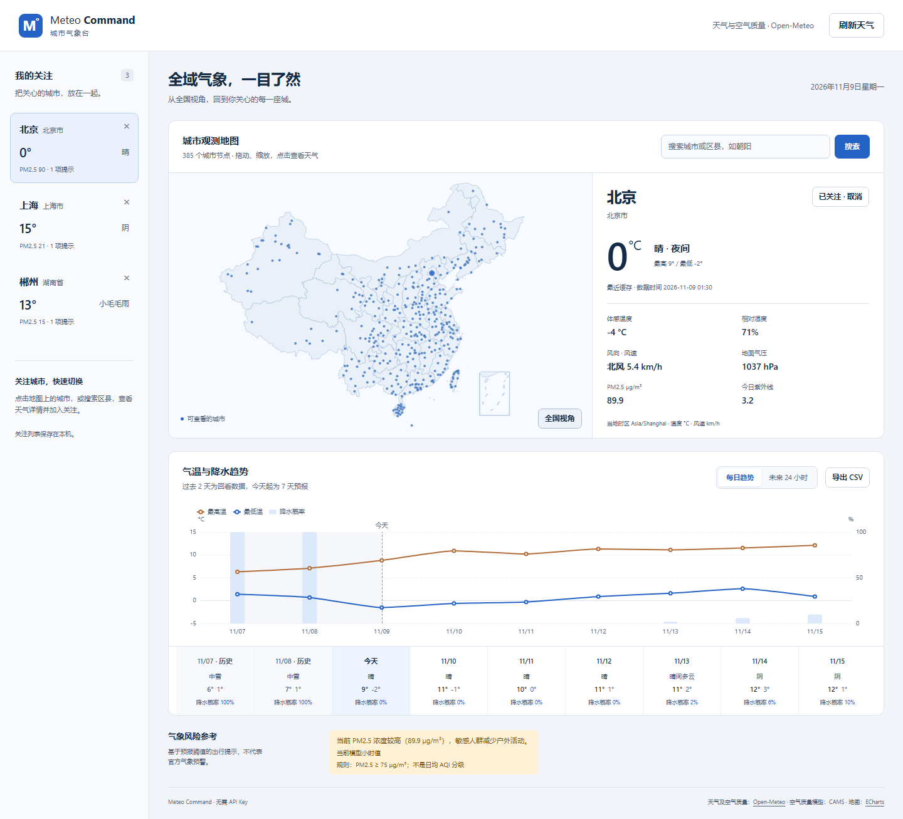

<div align="center">

# Meteo-Command

**把城市、预报与天气风险，放在同一张地图上。**

一个无需 API Key 的本地气象工作台。面向日常查询与个人研究，提供中国城市地图、逐小时预报、历史趋势和持续保存的关注列表。

[](https://github.com/SeanLIUXQ/Meteo-Command/releases)
[](https://www.python.org/downloads/)
[](https://github.com/SeanLIUXQ/Meteo-Command/actions/workflows/ci.yml)
[](LICENSE)

[下载 Windows 版本](https://github.com/SeanLIUXQ/Meteo-Command/releases/tag/v2.0.0) · [更新说明](RELEASE_NOTES.md) · [代码审查](docs/CODE_REVIEW.md) · [提交问题](https://github.com/SeanLIUXQ/Meteo-Command/issues)

</div>



> 本次实际运行截图，天气数值仅代表截图时的数据。天气与空气质量来自 Open-Meteo；城市地图与前端资源均随应用本地提供。

## 2.0 带来了什么

| 能力 | 使用方式 |
| --- | --- |
| 地图与多候选搜索 | 点击城市定位；搜索结果显示行政区域，区分同名城市。 |
| 24 小时逐时预报 | 查看温度与降水概率，安排接下来的出行。 |
| 过去 2 天 + 今天起 7 天 | 同屏比较历史模型数据与未来预报，并明确标注时间范围。 |
| 持久关注列表 | 关注城市在重启后保留，按城市身份区分同名地点。 |
| 可解释的天气风险 | 根据温度、风速、降水等阈值给出参考提示；缺失值保持为空。 |
| 缓存与服务降级 | 重复查询复用缓存；空气质量失败不影响天气，旧数据回退会明确提示。 |
| CSV 导出 | 导出当前城市的每日或逐时数据，方便个人分析。 |
| 本地运行包 | Windows 无需另装 Python；地图、图表脚本不依赖运行时 CDN。 |

风险提示由模型数据和应用规则生成，**不是气象部门发布的官方预警**。低温不能据此判定寒潮，大风不能据此判定台风，降雨也不能单独判定泥石流风险。

## 一键运行

### Windows：直接使用 Release

1. 在 [v2.0.0 Releases](https://github.com/SeanLIUXQ/Meteo-Command/releases/tag/v2.0.0) 下载 `Meteo-Command-v2.0.0-windows-amd64.zip`。
2. **完整解压**，保留 `Meteo-Command.exe` 旁的 `_internal` 文件夹。
3. 双击 `Start-Meteo.cmd`，浏览器会在服务就绪后自动打开。

默认地址：[http://127.0.0.1:5000](http://127.0.0.1:5000)。运行时保留终端窗口，按 `Ctrl+C` 退出。该包适用于 Windows x64；天气查询仍需要连接 Open-Meteo。未提供 macOS / Linux 预编译程序。

可用 PowerShell 校验下载文件，对照同一发布页的 `.zip.sha256`：

```powershell
Get-FileHash .\Meteo-Command-v2.0.0-windows-amd64.zip -Algorithm SHA256
```

### 源码：Windows、macOS、Linux

先安装 [Python 3.10+](https://www.python.org/downloads/)，再下载源码或克隆：

```bash
git clone --branch v2.0.0 https://github.com/SeanLIUXQ/Meteo-Command.git
cd Meteo-Command
```

Windows 双击 `Start-Meteo.cmd`；macOS / Linux 运行：

```bash
sh start.sh
```

脚本会创建项目内 `.venv`、安装依赖并启动。首次安装需要网络；部分 Linux 发行版需要先安装 `python3-venv`。也可以手动运行：

```bash
python -m venv .venv
# Windows: .venv\Scripts\activate
# macOS / Linux: source .venv/bin/activate
python -m pip install -r requirements.txt
python run.py
```

## 配置与数据

| 配置 | 默认值 | 说明 |
| --- | --- | --- |
| `METEO_HOST` | `127.0.0.1` | 监听地址；默认仅本机可访问。 |
| `METEO_PORT` | `5000` | 服务端口；被占用时可改成 `5001`。 |
| `METEO_NO_BROWSER` | 未设置 | 设为 `1` 禁用自动打开浏览器。 |
| `METEO_DATA_DIR` | 当前用户数据目录 | 关注列表存储位置；更新程序无需覆盖此目录。 |

命令行也支持 `python run.py --port 5001 --no-browser`。Release 可使用 `Meteo-Command.exe --port 5001`。

默认关注数据位置：

- Windows：`%LOCALAPPDATA%\Meteo-Command`
- macOS：`~/Library/Application Support/Meteo-Command`
- Linux：`$XDG_DATA_HOME/meteo-command`，未设置时为 `~/.local/share/meteo-command`

同一个服务实例的关注列表由所有访问者共享，最多关注 20 个城市。本版面向单用户本地使用。天气缓存有效期为 5 分钟，上游失败时可回退到 1 小时内的缓存，并显示旧数据提示。

v1 的收藏实际只保存在内存中，已随旧进程退出的数据无法恢复；如自行留存旧 JSON，请先备份，参见[迁移说明](docs/OPERATIONS.md)。

## Docker 部署

```bash
docker compose up --build -d
```

打开 [http://127.0.0.1:5000](http://127.0.0.1:5000)。Compose 默认仅绑定本机端口，并把关注列表保存到 `meteo-data` 命名卷；`docker compose down` 会保留卷。程序使用 Waitress WSGI 服务，Docker 容器以非 root 用户运行。

如需多人或公网访问，应在应用前配置身份认证、HTTPS 和访问控制；当前版本不提供账号隔离。部署、故障排查与构建方式见 [OPERATIONS.md](docs/OPERATIONS.md)。

## 开发与验证

```bash
python -m pip install -r requirements-dev.txt
python -m pytest -q
python scripts/build_release.py
```

浏览器回归脚本会修改关注列表，应对使用临时 `METEO_DATA_DIR` 的运行实例执行：

```bash
python -m pip install playwright==1.56.0
python -m playwright install chromium
python tests/browser_smoke.py --url http://127.0.0.1:5000
```

`python scripts/build_release.py` 在当前平台构建可执行程序，输出 `dist/` 下的 ZIP 与 SHA-256 文件。Windows 发布包须在 Windows 构建。CI 配置覆盖 Windows / Linux 和 Python 3.10、3.12、3.13；发布工作流构建 Windows 包并执行本地健康检查。具体已执行验证以 [Release Notes](RELEASE_NOTES.md) 为准。

```text
Meteo-Command/
├── app.py                    # Flask 兼容入口
├── meteo/                    # 城市目录、天气服务、关注存储与风险分析
├── run.py                    # Waitress 启动器与浏览器就绪探测
├── templates/                # 页面结构
├── static/                   # 样式、交互、本地图表库与地图
├── tests/                    # 回归测试
├── scripts/build_release.py  # 原生程序打包与校验和生成
├── docs/                     # 代码审查、运维与界面预览
└── .github/workflows/        # 持续检查和发布构建
```

保留原有 `/api/map_data`、`/api/saved_cities`、`/api/find_city`、`/api/manage_city` 与 `/api/weather_detail` 接口；新增 `/api/search_cities?q=城市名` 多候选查询和 `/api/health` 本地健康检查。

## 数据来源与使用范围

- 天气：[Open-Meteo Weather API](https://open-meteo.com/)，提供模型数据而非逐站实测值。
- 空气质量：[Open-Meteo Air Quality API](https://open-meteo.com/en/docs/air-quality-api)，底层包含 [CAMS](https://atmosphere.copernicus.eu/) 数据；PM2.5 单位为 μg/m³，缺失时不会显示为零。
- 地图与图表：本地 Apache ECharts 5.6.0 和固定版本历史地图，仅作可视化参考，不作为导航或行政边界依据。

Open-Meteo 免费服务面向非商业使用并有调用配额；商业用途请核对其[服务条款](https://open-meteo.com/en/terms)及订阅方案。缓存只减少重复请求，无法保证上游始终可用，也不提供离线天气预报。

项目代码采用 [MIT License](LICENSE)。第三方软件、地图和继承的城市目录有各自的来源与授权说明，详见 [THIRD_PARTY_NOTICES.md](THIRD_PARTY_NOTICES.md)。

## 下一步

本轮已实现内容见上方功能表；下列是后续候选方向，尚未包含在 2.0：

- 多城市同屏对比与可保存的比较视图。
- 适配有明确授权和来源的官方预警接口。
- 可选 PWA、天气通知与订阅规则。
- 用户独立关注列表、认证和部署权限管理。

欢迎通过 [Issues](https://github.com/SeanLIUXQ/Meteo-Command/issues) 描述问题、复现步骤和运行环境，或提交附带验证说明的 Pull Request。
